<p align="center">
  
</p>

<h1 align="center">ThinkThrice · 三思</h1>

<p align="center"><b>A chat app that won't let you send the message you'll regret.</b><br>
Your 1:30 a.m. 「我想复合了」 and your furious reply to the boss stay frozen in ice until you've cooled down.</p>

<p align="center">CPX Hackathon · Track 2 「逆向 UX 挑战赛」 (Reverse UX) · iOS 26 · SwiftUI · on-device Core ML</p>

<p align="center">
  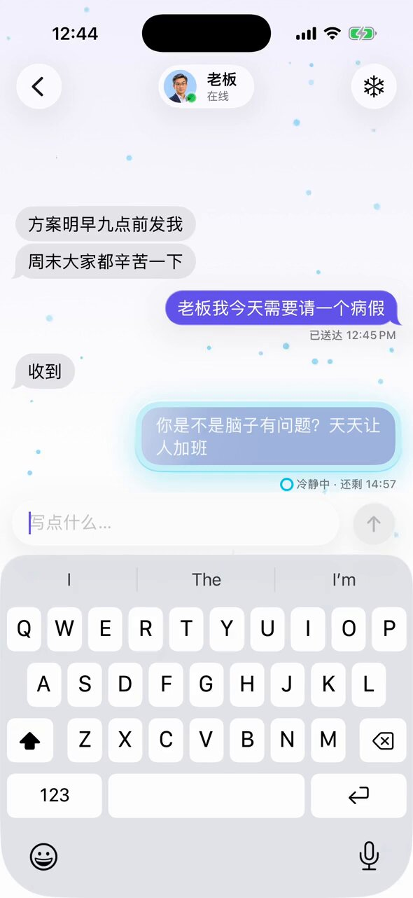
  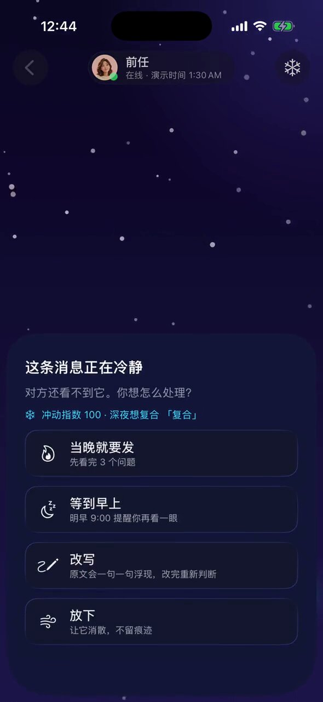
  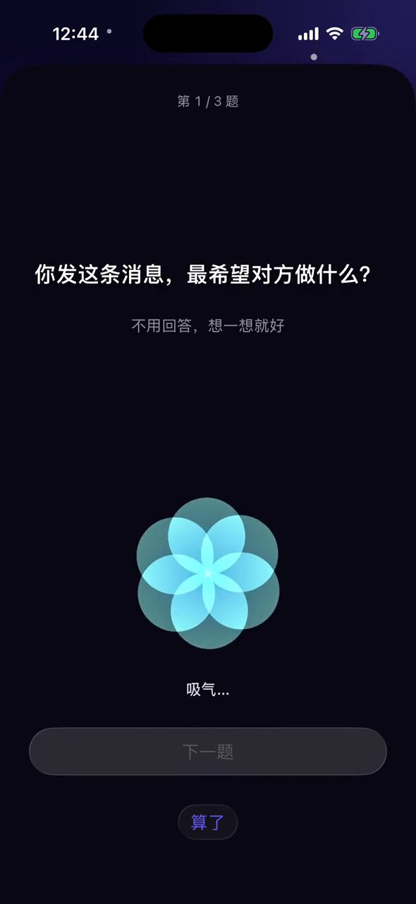
</p>

## Why

Everyone has sent a message they regretted: a furious reply to a boss, or a late-night "can we try again?" to an ex. Those messages have two things in common: they are written at the emotional peak, and they are sent instantly.

Every chat app competes to make sending faster. Track 2 asks for an app users hate but still have to use, so we flipped the goal: **ThinkThrice deliberately makes it hard to send the messages you'll regret.** The frustration is the feature, and every frustration protects something.

ThinkThrice pauses you, but it never decides for you. A frozen message is never deleted without your consent, and there is always a way out. It turns an instant reaction into a conscious choice.

## How it works

Every message you send is scored on the phone by a local model plus rules, judged by **what you say, who you say it to, and when**. Calm messages are delivered right away. Impulsive ones freeze in a glass shell with a countdown, and the app calls them 「冷静中」 (cooling down):

- **By day**, a frozen message cools down for 15 minutes.
- **Between 22:00 and 6:00**, it cools down until 9:00 the next morning.

The same words land differently: 「在吗」 to an ex is delivered, 「我想复合了」 is frozen but only late at night, and an insult to your boss is frozen at any hour.

While a message is frozen you always have four ways out:

| Way out | What happens |
|---|---|
| **Send it now** (「当晚就要发」 at night) | Answer a reflection question while breathing along with a breathing flower. The button unlocks after three 5-second breaths. One question by day, three at night. |
| **Wait** | When it has cooled down you get a notification (「昨晚 1:30 的那条冷静好了」) and one last question: 「睡了一觉，你还想把它原样发出去吗？」 |
| **Rewrite** | The original thaws back into the editor one sentence at a time, then the rewrite is scored again. Calm now: delivered. Still impulsive: frozen again. |
| **Let go** | The message shatters into ice dust and disappears. |

<table>
  <tr>
    <td align="center">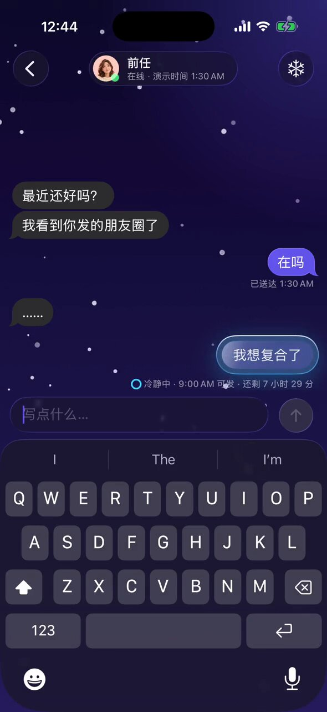<br>Late night: until 9:00</td>
    <td align="center">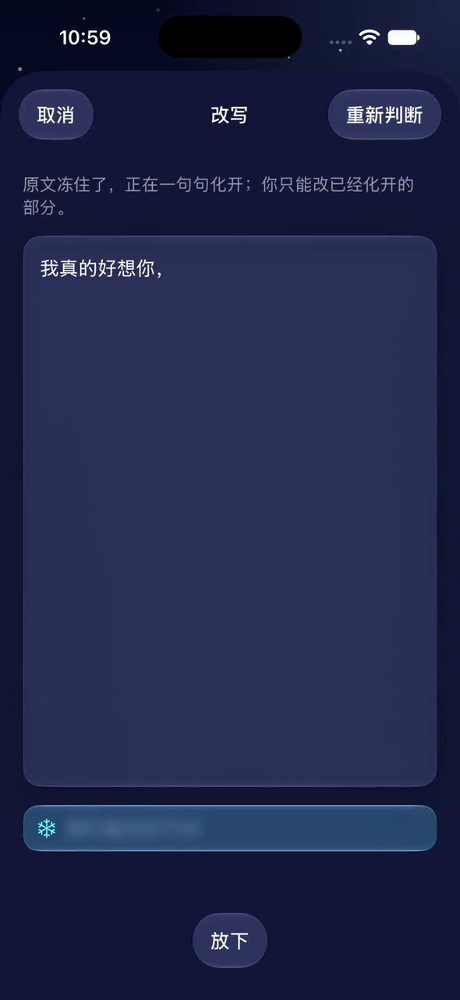<br>Rewrite: thaws by sentence</td>
    <td align="center">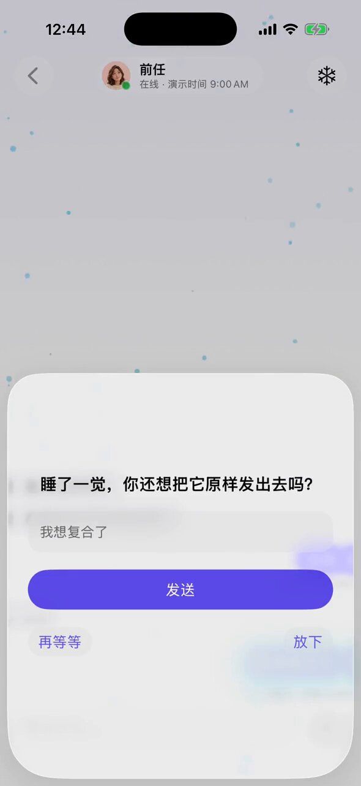<br>9:00: asked once more</td>
    <td align="center">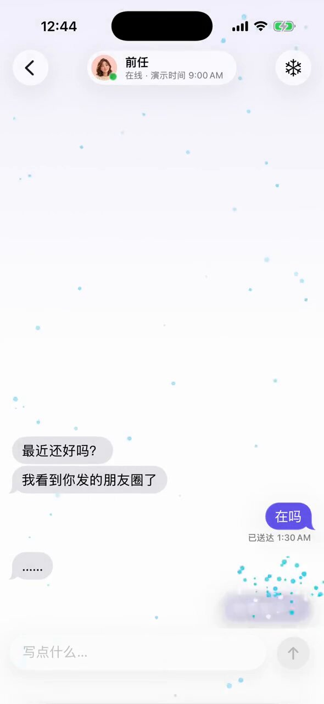<br>Let go: ice dust</td>
  </tr>
</table>

## Frustrations, designed on purpose

Track 2 requires at least three deliberately frustrating interactions with the design reasoning behind them. ThinkThrice has six. Each one breaks a usability rule on purpose and protects something in return.

| # | Frustration | Rule it breaks on purpose | What it protects |
|---|---|---|---|
| 1 | You press Send and the message freezes instead of sending | User control and freedom | The first 15 minutes after the emotional peak |
| 2 | Late-night messages are frozen until 9:00, no negotiation | Flexibility | The hours when judgment is worst |
| 3 | To send anyway, you breathe through 1–3 questions, 15 s each | Efficiency of use | Real urgency survives 45 seconds; an impulse doesn't |
| 4 | Rewriting reveals your original one sentence at a time | Efficiency of use | You re-read every word you wrote in anger |
| 5 | Viewing a frozen message can require Face ID | User control and freedom | You can't keep reopening it and getting angrier, and nobody else can read it |
| 6 | The Dynamic Island keeps counting down, with no "let go" button | User control | Letting go is a decision you make inside the app, not with a swipe |

### Design principles

- **Legible friction.** People accept friction when they can see why it's there. The action panel always says why a message froze (「冲动指数 100 · 深夜想复合 「复合」」).
- **Always a way out.** Every frozen message can be sent, rewritten, waited out or let go. Nothing is deleted without your consent.
- **Context over keywords.** The same sentence is fine at noon and risky at 1:30 a.m., fine to a teammate and risky to your boss.
- **Private by default.** Scoring runs on the phone. A frozen message's text never leaves the device, and the Dynamic Island and Lock Screen never show it.
- **Accessible.** VoiceOver labels on frozen messages, and Reduce Motion turns off the freeze burst, breathing animation, ice dust and snow.

We build on earlier "purposeful friction" ideas: Gmail's Mail Goggles (2008) made you solve math problems before sending email late at night, one sec adds a pause before opening social apps, and Alarmy makes you do a task to turn off your alarm. Mail Goggles only looked at the clock; ThinkThrice looks at what you are saying and who you are saying it to.

## More screens

<table>
  <tr>
    <td align="center" width="50%">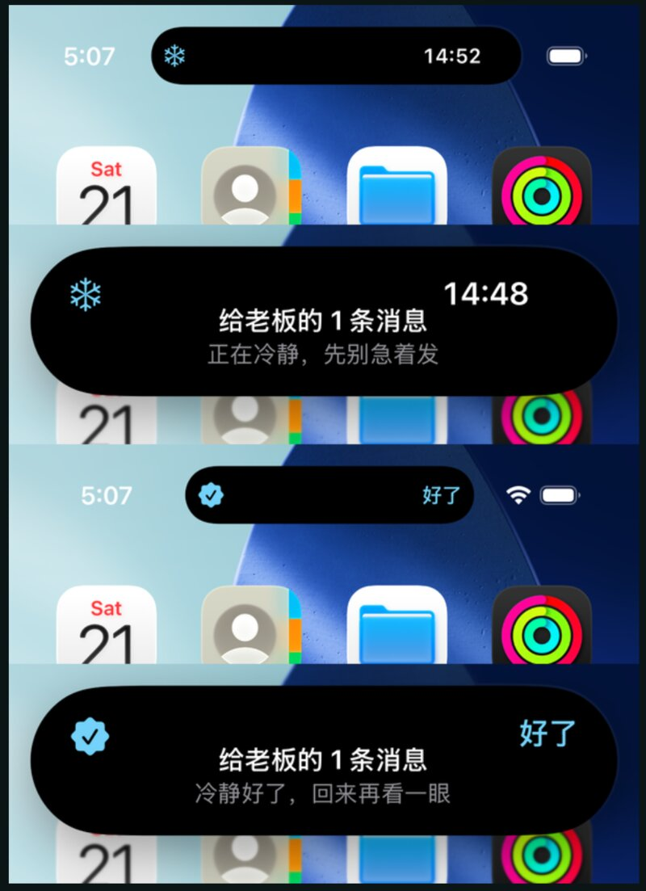<br>Dynamic Island and Lock Screen: a countdown, never the message text</td>
    <td align="center" width="50%">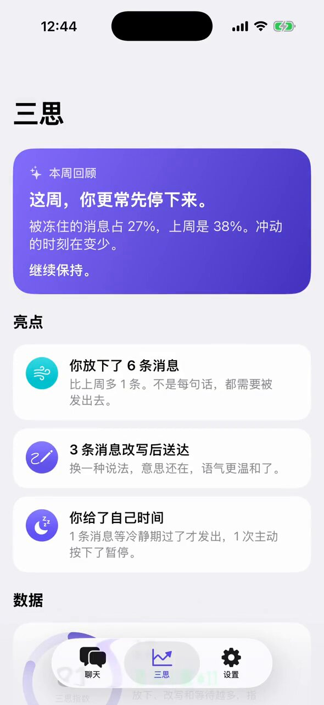<br>三思 weekly review, in the style of Screen Time (example data)</td>
  </tr>
  <tr>
    <td align="center" colspan="2">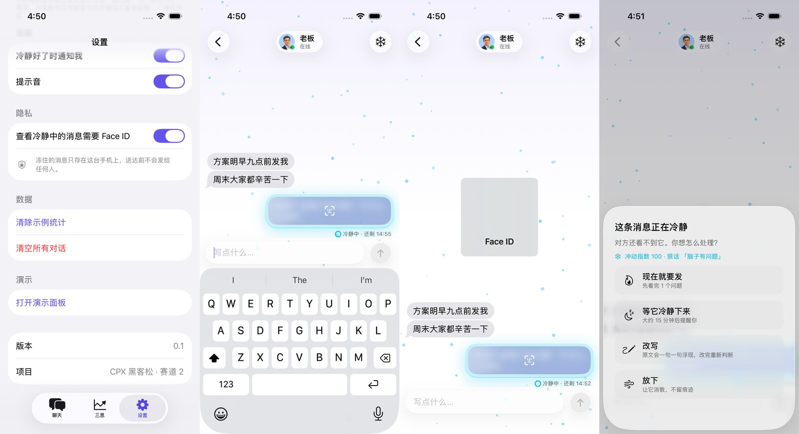<br>Face ID: frozen messages blur until you authenticate</td>
  </tr>
  <tr>
    <td align="center">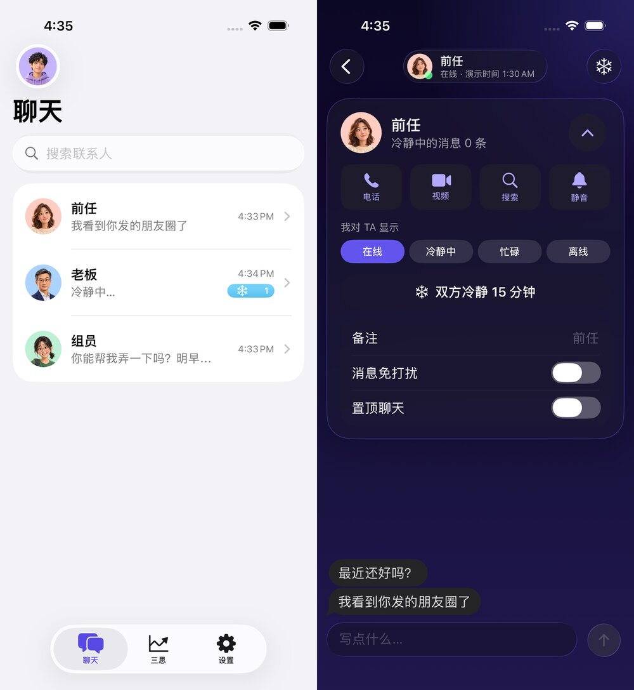<br>Chats with a held-message badge; contact card with the two-sided 「双方冷静 15 分钟」 pause</td>
    <td align="center">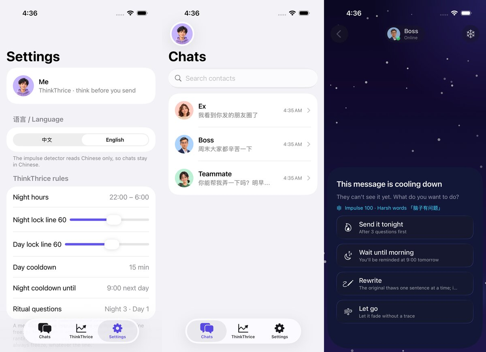<br>In-app 中文 / English switch (chats stay Chinese: the detector reads Chinese)</td>
  </tr>
</table>

Also in the app: a starry night sky and falling snow while something is frozen, haptics for every step (a heavy-then-rigid "crack" when a message freezes), a profile page with badges, contact search, and an optional two-phone mode over peer-to-peer Wi-Fi.

Screenshots are from the iOS simulator.

## How it's built

- **Swift and SwiftUI on iOS 26** with Liquid Glass. Chat UI on [ExyteChat](https://github.com/exyte/Chat) with our own iMessage-style bubbles. The Xcode project is generated from `project.yml` with XcodeGen and committed.
- **CalmCore**, a Swift package with no UI: one reducer owns every change to a message (`scoring → delivered | settling → ritual | confirming | rewriting → delivered | dissolved`), so the four exits, relaunches and countdowns never disagree. Each conversation is saved as a JSON snapshot and restored through the same reducer.
- **On-device detector, two layers.** A Create ML classifier on Apple's Chinese BERT embeddings (`NLContextualEmbedding`) with a small fallback model, plus keyword rules for insults, ranting at the boss, and late-night "get back together" or "I quit" messages. The model's score is weighted by the recipient:

  impulse = (0.7 × 100 × p(angry) + 0.3 × punctuation) × scene factor (ex 2.0, boss 1.6, others 1.0)

  A message freezes when the score reaches 60 or a rule fires.
- **Apple frameworks**: Core ML and NaturalLanguage, ActivityKit and WidgetKit (Dynamic Island), LocalAuthentication (Face ID), UserNotifications, haptics, and Network.framework for the two-phone mode.
- **A demo clock**, so the demo can jump to 1:30 a.m. or fast-forward to 9:00 instead of waiting overnight.

## Build and run

Requires a Mac with Xcode 26 or later; the app runs on iOS 26 or later (iPhone or simulator).

1. Open `ThinkThrice.xcodeproj`, choose your team under Signing & Capabilities for the `ThinkThrice` and `ThinkThriceWidgets` targets, and run the `ThinkThrice` scheme. The first build is slow because Swift Package Manager fetches ExyteChat and its dependencies.
2. Run the core tests (state machine, detector, acceptance sentences): `cd CalmCore && swift test`.
3. Run the end-to-end UI test (every exit plus a relaunch) on an English iPhone simulator: `xcodebuild -project ThinkThrice.xcodeproj -scheme ThinkThrice -destination 'platform=iOS Simulator,name=iPhone 17 Pro' test -only-testing:ThinkThriceUITests/ThinkThriceUITests/testFlow`.
4. After editing `project.yml` or adding files under `App/`, run `xcodegen generate` and commit the regenerated project.

On a fresh device the main model needs iOS to download the Chinese BERT assets first (about a minute online); until then the fallback model and rules decide. Open the app online a few minutes before a demo.

**Demo controls**: in a chat, press and hold the contact header (or 设置 → 打开演示面板) to jump to 01:30, fast-forward to 09:00, adjust the lock lines, score any sentence against the live detector, or clear everything for a fresh run.

**Try it**: to 老板, send 「老板我今天需要请一个病假」 (delivered), then 「你是不是脑子有问题？天天让人加班」 (frozen). Jump to 01:30, and to 前任 send 「在吗」 (delivered), then 「我想复合了」 (frozen until 9:00).

## Repository

```
App/          SwiftUI app: chat, sheets (ritual, confirm, rewrite), 三思, settings, models in App/Model
CalmCore/     Swift package: state machine, time policy, detector rules, tests and acceptance fixtures
Widgets/      Dynamic Island and Lock Screen Live Activity extension
Shared/       Live Activity attributes shared by the app and the extension
UITests/      XCUITest flows (every exit, relaunch, tour, stats, search)
docs/         HANDOFF.md (technical handoff), TEAM_SYNC.md (team update, in Chinese), screenshots/
project.yml   XcodeGen spec for ThinkThrice.xcodeproj
```

[docs/HANDOFF.md](docs/HANDOFF.md) covers the architecture, the detector contract, persistence, the two-phone mode and known issues. [docs/TEAM_SYNC.md](docs/TEAM_SYNC.md) covers installing on teammates' iPhones and the stage script.

## Team

- **Sean Ja** ([@SeanJA239](https://github.com/SeanJA239)): iOS app, interaction design.
- **睿洋 (Ryan)**: impulse detector model and keyword rules (`App/Model/`, `CalmCore/Sources/CalmCore/ThinkThriceRules.swift`).
- **Christina Cao**, **Ruiqi Liu** and **Roman Yeh**.

## Limitations

- The detector misses sarcasm and indirect messages, and can freeze ordinary venting.
- iOS doesn't let third-party apps intercept other apps' messages, so ThinkThrice is its own chat app with scripted contacts; a real version would need to be built into a messenger.
- The two-phone mode has not been tried on two real iPhones.
- We have not run a user study; whether people actually send fewer regretted messages is still an open question.
